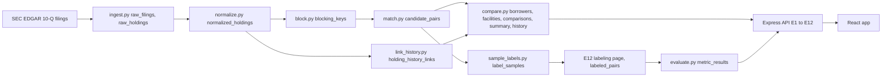

# Cross-Lender Private Credit Valuation Monitor

Do two lenders agree on what the same private loan is worth? This project reads the public SEC quarterly filings of three business development companies (BDCs), works out which holdings are the same syndicated loan, and compares the fair values the lenders report for it.

Measured quarter: 2026-06-30. BDCs: Apollo Debt Solutions BDC (ADS), HPS Corporate Lending Fund (HPS) and Blue Owl Credit Income Corp. (ORCIC). A second quarter, 2026-03-31, is ingested as history and as an out of time check.

Every number below comes from `metric_results` (through `GET /api/metrics`), `docs/data_report.md`, or a query run on the live database on 2026-10-31. Nothing here is an estimate made by hand.

## What this is not

- Not a reconstruction of Apollo's internal valuation process.
- Not a claim that ICE IDs are being reverse engineered.
- Not market wide: 3 BDCs and one measured quarter.
- No cross quarter claim. History shows the prior quarter marks of the same positions. It is not a trend and not a measured matching result.

## Evaluation (read this first)

The matcher is frozen: its configuration and source files hash to `6b32a3b896b7556d7c9bfb6261028ebc1fb870c5608079b2b06aa1c74d2387fc`, stored in `matcher_freeze` before the held out sample was drawn. `evaluate.py` refuses to run if that hash changes. No label moved a threshold or a rule. Review queue confirmations are in no figure below. How the sample was drawn and labeled is in `DECISIONS.md` (sections 17 to 24), not in a separate methodology page.

Labels have three values: MATCH, NO_MATCH and UNSURE. Because UNSURE pairs can hide errors, every precision is shown three ways, each with a 95% Wilson interval:

- UNSURE excluded (the headline): MATCH over MATCH plus NO_MATCH.
- Worst case: UNSURE counted as wrong.
- Best case: UNSURE counted as a match.

### Held out sample, measured quarter

Frame: the 313 candidate pairs of 2026-06-30 minus the 40 diagnostic tuning pairs, banded by their stored score. The AUTO band was sampled at random (60 of 245). Every other band was small enough to label in full.

| Band | Frame | Labeled | MATCH | NO_MATCH | UNSURE |
|---|---|---|---|---|---|
| AUTO (score at or above 0.92) | 245 | 60 | 55 | 0 | 5 |
| REVIEW | 5 | 5 | 1 | 0 | 4 |
| Just below | 9 | 9 | 4 | 0 | 5 |
| Low | 14 | 14 | 6 | 2 | 6 |

AUTO only precision, the headline (this is what ships with no human review):

| Treatment of UNSURE | Result | 95% interval |
|---|---|---|
| UNSURE excluded | 55 of 55 = 100.0% | 93.5% to 100.0% |
| Worst case | 55 of 60 = 91.7% | 81.9% to 96.4% |
| Best case | 60 of 60 = 100.0% | 94.0% to 100.0% |

Bands that were labeled in full are reported as counts, not as estimates. The REVIEW band: 1 of 5 matched, 4 were unsure. In the two bands below the AUTO and REVIEW threshold the MATCH count is the number of true matches the matcher did not put in a predicted band: 4 of 9 and 6 of 14. These are not precisions.

The raw UNSURE count is 20 of 88 held out labels (22.7%).

Band weighted figures (optional, secondary): if REVIEW pairs were auto accepted, worst case precision is 90.2% (82.1% to 96.8%). Recall given blocking for AUTO only is between 90.4% (best case) and 95.3% (worst case). The bootstrap interval has no width when every sampled label in a band is a match, so treat these as secondary to the table above.

### Out of time check, prior quarter (separate, never pooled)

After the freeze, 42 pairs of the 2026-03-31 candidate pairs were drawn and labeled: 30 of 298 AUTO pairs at random and every REVIEW (5) and just below (7) pair; the low band (13) was not sampled. It is a report only check that the matcher behaves on a quarter it was not built on.

| Band | Frame | Labeled | MATCH | NO_MATCH | UNSURE |
|---|---|---|---|---|---|
| AUTO | 298 | 30 | 28 | 2 | 0 |
| REVIEW | 5 | 5 | 0 | 4 | 1 |
| Just below | 7 | 7 | 2 | 1 | 4 |
| Low | 13 | 0 | not sampled | | |

AUTO precision: 28 of 30 = 93.3% (78.7% to 98.2%). There is no UNSURE in this band, so all three treatments agree.

### Sensitivity of the out of time result to two labels

Two of the 30 AUTO labels are NO_MATCH (Cotiviti and Puma Buyer). Both pairs have exactly equal normalized names and a score of 1.0, and their industries differ. Among the 282 measured quarter AUTO pairs with equal normalized names, 178 have differing industries, and all 32 decided held out pairs with that pattern are MATCH. The stored labels were not changed. If those two were UNSURE, UNSURE excluded would be 28 of 28 = 100.0% (87.9% to 100.0%) and the worst case would stay 28 of 30 = 93.3%. If they were MATCH, it would be 30 of 30 = 100.0% (88.6% to 100.0%). This table does not say which is right. See `DECISIONS.md` section 24, which also records who made those two decisions.

### Blocking recall

Not yet measured. The independent 30 holding check (`docs/blocking_recall_worksheet.md`) needs a hand search for counterparts. Pairs avoided, below, is never quoted without it.

### Labeling provenance

`DECISIONS.md` section 24 records the following and nothing more. The two NO_MATCH decisions on the out of time AUTO pairs for Cotiviti, Inc. (pair 134) and Puma Buyer (pair 149) were made by the AI assistant during the labeling conversation, not by the project owner. The assistant treated the conflicting industries as evidence of different borrowers. A later review of the stored text (24 fields) found no stored text naming a different company, so those two decisions are questionable on later review. The stored labels were not changed.

> OWNER TO COMPLETE: who made each of the other 168 labels, how, and what independent evidence rule was applied to each phase. Until this line is completed, the README makes no claim about it.

### Limits of the evaluation

- Recall is given blocking, not over all possible matches. The labeled pairs all share a block by construction.
- Fuzzy name scoring adds almost nothing on this data: 282 of the 283 AUTO pairs in the measured quarter have exactly equal normalized names. The matcher's work is done by normalization and blocking, and scoring separates only the small bands.
- Tranche awareness: a MATCH confirms the borrower, not the tranche. HPS holdings are typed by lien class only, so a MATCH on a pair with an HPS holding does not show the same tranche.
- Renames the normalizer does not unify (holding company, midco and merger sub words, "dba" names) are missed in the below threshold bands. Of the 13 non AUTO pairs labeled MATCH, my reading of the names gives 4 holdco, 4 dba, 2 midco, 2 merger sub and 1 sibling. These counts are in `DECISIONS.md` section 23.
- Labels were made with independent evidence (industry, footnotes, other filing names) and attributes, never attributes alone. The "other filing names" shown while labeling use exact equality of the matcher's own normalized names: independent of scores and bands, not of normalization.
- The held out sample is small (88 labels, 20 of them UNSURE). Intervals are wide for that reason.
- Borrower grouping is exact equality of the facility's most frequent normalized name and was not measured separately.

## Divergence and triage

A facility is a group of holdings from at least two lenders that the matcher put together. Divergence is the highest minus the lowest fair value as a percent of par, in points: under 1.0 is AGREEMENT, 1.0 up to 2.0 is MILD, 2.0 or more is FLAGGED. On the measured quarter: 93 facilities across 85 borrowers; 72 AGREEMENT, 9 MILD and 12 FLAGGED.

Divergence sensitivity (facilities at or above each cutoff): 1 point 21, 2 points 12, 5 points 3.

Triage ranks flagged facilities by exposure: `exposure_usd = divergence points / 100 * the smallest principal among the compared holdings`. It is a ranking key, not an estimate of loss.

### Evidence (signals present, not causes)

For each facility the filing facts that sit next to the gap are shown: cost, cost as a percent of par, fair value as a percent of cost, spread, floor, PIK, maturity and non accrual, each with its source link. Seven signals fire when a disclosed difference crosses a threshold fixed before any result was seen (`DECISIONS.md` sections 26 and 27). The layout is designed around the analyst's decision. It was not validated with analysts.

| Signal | FLAGGED facilities with it (of 12) | AGREEMENT facilities with it (of 72) |
|---|---|---|
| Cost basis gap | 3 | 3 |
| Non accrual | 2 | 0 |
| PIK differs | 1 | 0 |
| Rate type differs | 2 | 0 |
| Spread differs | 0 | 1 |
| Floor differs | 0 | 0 |
| Maturity differs | 0 | 0 |

8 of the 12 flagged facilities carry no signal. Those are the ones an analyst has to investigate by hand. The counts are too small to say that any signal separates flagged from agreeing facilities. Floor is disclosed for ADS and HPS only, never ORCIC (field coverage per BDC is on the Metrics page).

### History (two quarters are not a trend)

Matches are decided once, on the measured quarter. For each holding the same holding in the same BDC one quarter earlier is linked, and its prior mark is read. 1,260 of 2,127 holdings link (1,157 by exact key, 103 by exact maturity). 64 of 93 facilities have a prior gap: 5 closed, 1 narrowed, 52 stable, 6 widened; 29 have no prior. The link itself has not been hand checked yet, so its accuracy is not reported. HPS links are limited because only 433 HPS holdings have a percent of par on 2026-03-31.

## Data and measured limits

- Currency. Where a principal unit is filed it decides the currency. HPS 2026-03-31 tags principal amounts without a unit, so a ladder fills the gap: rung (b), a reference rate code that maps to one currency, is enabled (it set 510 rows, all USD). Rungs (a) and (c) were below the 99% agreement bar and are disabled. 144 HPS rows on 2026-03-31 stay unknown, and 21 of them carry the reason CURRENCY_UNKNOWN (the rest are unfunded commitments). For ADS the unit is filed, so the ladder is not needed on 2026-06-30; its rung (c), a link to the 2026-06-30 holding, agreed on currency for 449 of 471 links (95.33%) and is disabled (`SPEC.md` section 6). On 2026-06-30 no row is CURRENCY_UNKNOWN. Details are in `SPEC.md` section 6 and `DECISIONS.md`.
- Revolvers and unfunded commitments. A position's principal is its funded amount. Holdings whose footnote marks an unfunded commitment are excluded from comparisons and counted. Unfunded commitment amounts are not parsed, so a drawn revolver is not netted against a term loan and undrawn amounts are not shown. This is future work.
- Equity positions are excluded from comparison. A second quarter is ingested and normalized but is not matched, except for the out of time sample.
- IDs of borrowers, facilities and clusters are regenerated on every `compare.py` run. They are stable across page loads, not across a rebuild.
- A cluster where two holdings from one BDC land together goes to the review queue and needs manual resolution.

### Data report

From `docs/data_report.md` (generated by `python -m pipeline.report`, read only):

- Rows parsed per filing: ADS 816 rows (636 funded rows with a fair value of 637 funded), HPS 796 (755 of 755), ORCIC 515 (461 of 461).
- Blocking efficiency: all_pairs 1,479,716 (from per BDC counts 515, 816 and 796), candidate_pairs 313, pairs avoided 99.9788%. Blocking recall is not yet measured, so this figure alone does not show the blocker is good.
- Run times, median of the last 3 runs, wall clock including Python start and the database connection: compare 1.139 s (run after the freeze), block 0.303 s and match 0.117 s (last run on 2026-10-30, before the freeze). `normalize.py` has no recorded time. The config hash field in `docs/run_times.jsonl` is empty on every line.
- Machine: Windows 11, 12 logical CPUs, 15.7 GB RAM, Python 3.11.0, Node v24.13.0, Docker 29.8.2, Postgres 16 in a container on the same host.
- Report only. Blocking is never retuned to improve these figures.

## Architecture



- Python 3.11 pipeline run as `python -m pipeline.<module>`, never imported by the API. Node 24, Express 5 and plain JavaScript (ES modules) for the API, React 19 and Tailwind for the web app, Postgres 16, Docker Compose v2. No ORM: parameterized SQL only.
- Config lives in `pipeline/config.yaml`; secrets and `MEASURED_PERIOD_END` in `.env`. The matcher hash covers the normalization, blocking, scoring, bands and filers sections and the four matcher source files.
- Write surface: E7 and E8 update `candidate_pairs.status` only, and a Confirm or Reject changes no curated table until `compare.py` is re-run. E12 writes `labeled_pairs` only and is mounted only when `ENABLE_LABELING=true` (default false).
- Schema: 23 tables, summarized in `SPEC.md` section 6. Raw (`raw_filings`, `raw_holdings`), staged (`normalized_holdings`, `blocking_keys`, `candidate_pairs`), curated (`canonical_borrowers`, `canonical_facilities`, `holding_facility_map`, `facility_comparisons`, `facility_summary`, `review_clusters`, `review_cluster_members`, `facility_history`, `holding_history_links`, `history_build`), evaluation (`matcher_freeze`, `label_samples`, `band_sizes`, `outoftime_band_sizes`, `labeled_pairs`, `blocking_recall_checks`, `history_link_checks`, `metric_results`) and `schema_migrations`.
- API contract: `CONTRACT.md` is the only place endpoint shapes are defined.
- Source URL convention: every holding level row carries `source_url`, the SEC filing it came from, through every table and into every API row. A number from a filing links to its source in one click.

## Glossary

- BDC: a public fund that lends to private companies.
- Syndicated loan: one loan shared by several lenders.
- Fair value: the fund's own estimate of what a holding is worth.
- Par: the face amount of the loan.
- Mark: the fair value written as a percent of par.

## Splink

Not built. The matcher is token sort ratio on the normalized name with blocking on attributes, and no Splink result is claimed.

## If this ran at scale (ideation, not built)

- Partition blocking, scoring and comparison by block key across workers, since blocks are independent.
- Incremental ingestion when a new filing appears.
- Stable IDs across rebuilds.
- Cross quarter matching as its own measured step with its own labeled evaluation; only the within BDC history link exists today.
- Full coverage of the roughly 40 to 50 public BDCs.

## How to run

```bash
cp .env.example .env     # set SEC_USER_AGENT and MEASURED_PERIOD_END
docker compose up
```

The web app is on http://localhost:8080 and the API on http://localhost:3000. Pipeline jobs run as `docker compose run --rm pipeline python -m pipeline.<module>`. Tests: `pytest` (needs `DATABASE_URL`), `npm test` in `api`, and `npm run build` in `web`.

The matcher is frozen. Do not run `normalize`, `block` or `match` again and do not run `config --unfreeze` unless you mean to discard the held out set.
