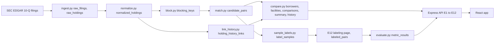

# Cross-Lender Private Credit Valuation Monitor

Several lenders often hold slices of the same private loan, and each reports its own fair value for its slice. This project reads the public SEC quarterly filings of three business development companies (BDCs), works out which holdings are the same syndicated loan, and compares the fair values the lenders report for it, as a percent of par.

- Measured quarter: 2026-06-30.
- BDCs: Apollo Debt Solutions BDC (ADS), HPS Corporate Lending Fund (HPS) and Blue Owl Credit Income Corp. (ORCIC).
- A second quarter, 2026-03-31, is ingested as history and as an out of time check. It is never matched in the main run.
- Data: Inline XBRL and the filing HTML of each 10-Q, parsed directly (no companyfacts API). Every holding level row carries the URL of the SEC filing it came from.

Every number below comes from `metric_results` (through `GET /api/metrics`), `docs/data_report.md`, or a query run on the live database on 2026-10-31. Where a number could not be sourced it is left out.

## What this is not

- Not a reconstruction of Apollo's internal valuation process.
- Not a claim that ICE IDs are being reverse engineered. ICE IDs are assigned at origination from deal documents; this project resolves identity afterwards, from public filings.
- Not market wide: 3 BDCs and one measured quarter.
- No cross quarter claim. History shows the prior quarter marks of the same positions. It is not a trend and not a measured cross lender matching result.
- Not a loss estimate. Exposure is a ranking key.

## How it works

1. **Ingest.** Per filer adapters read each 10-Q into `raw_holdings` (one row per schedule line, with its source URL). Ingest is idempotent and checks a committed hash of each filing document.
2. **Normalize.** Borrower names are lower cased and stripped of legal suffixes, `dba` and `fka` clauses and punctuation. Digits are kept, so "acme holdings 2" and "acme holdings" stay different. Instrument type is mapped from the printed text (HPS prints only the lien class). Spread, floor and PIK are parsed from the rate string.
3. **Percent of par, with guards.** `fair_value_pct_par` is fair value divided by principal. It is NULL (never a division by zero) when the principal is null or zero, when the row is equity, when the footnote marks an unfunded commitment, or when the principal is not in USD. The last rule matters for ADS: 101 of its 816 schedule rows (12.4%) print the principal in another currency (EUR 48, GBP 38, CAD 7, AUD 4, JPY 1, KRW 1, NOK 1, SEK 1) while fair value is in USD. Dividing would mix currencies, and the filings carry no exchange rate, so those rows keep their data and are excluded from comparisons with the reason NON_USD_PRINCIPAL. ADS has 534 rows with a percent of par; the other 282 are the 101 above, 150 with zero or null principal, 30 equity and 1 with no fair value. The currency of rows with no filed unit is set by a validated ladder (see limits).
4. **Block.** Two holdings become a candidate pair only if they are in different BDCs, are in the measured period, have the same instrument type, share a name prefix block key (the first 4 characters or the first token), have maturities within 3 months and, when both are present, spreads within 50 bps. Types OTHER and EQUITY are never candidates. Of 1,479,716 possible cross BDC pairs, 313 are candidates (99.9788% avoided).
5. **Score.** The score is `token_sort_ratio` on the normalized names only, divided by 100. A digit guard caps the score at 0.79 when the two names contain different digit tokens, so a numbered entity can never reach AUTO. Attributes decide candidacy in step 4, not the score.
6. **Classify.** A score of 0.92 or more is AUTO, 0.80 up to 0.92 is REVIEW (0.80 is inclusive), and below 0.80 is NO_MATCH. For evaluation, below 0.80 is split into JUST_BELOW (0.65 and above) and LOW. These thresholds were fixed before any label was made and no label has moved them.
7. **Cluster into facilities.** AUTO and CONFIRMED pairs join holdings into clusters. REJECTED pairs are cannot link constraints. A cluster with two marked holdings from one BDC is not turned into a facility: it goes to the review queue. A cluster is a facility only if at least two of its holdings have a percent of par. Facilities are grouped into borrowers by exact equality of the facility name.
8. **Compare.** Divergence is the highest minus the lowest percent of par over the facility's included holdings, in points. Under 1.0 is AGREEMENT, 1.0 up to 2.0 is MILD, 2.0 or more is FLAGGED.

## Evaluation (read this first)

The matcher is frozen. Its configuration and source files hash to `6b32a3b896b7556d7c9bfb6261028ebc1fb870c5608079b2b06aa1c74d2387fc`, stored in `matcher_freeze` before the held out sample was drawn. `evaluate.py` and the sampling script refuse to run if that hash changes. No label moved a threshold or a rule. Review queue confirmations are in no figure below.

### Why the evaluation is not circular

- **The labels do not use the matcher's score.** The score depends on the normalized names only. A label rule that defined "same facility" by name score, type, maturity window and spread window would simply reproduce the matcher. The labeling rule instead requires at least one independent signal (industry, footnote text, the borrower's names in other filings, or a public credit agreement) and never attributes alone. Principal size is not evidence, because different lenders hold different slices of one syndicated loan.
- **The labeling page hides the score, the status, the band, the phase and the draw order.** E11 never selects them, and a test checks this, so a label is not anchored to the matcher's answer.
- **Order of steps.** About 40 randomly drawn candidate pairs were labeled first, for diagnostics only (to find normalization bugs). The matcher was then frozen, and the held out sample was drawn from the frozen score bands, so the band edges could not be adjusted after seeing labels.
- **Review queue clicks are not labels.** A Confirm or Reject is made with the score on screen, so it is not ground truth. `evaluate.py` never reads `candidate_pairs.status`.
- **A stated residual dependence.** The "other filing names" shown while labeling use exact equality of the matcher's own normalized names. That evidence is independent of scores and bands, but not of normalization.

### What the metrics mean

- Labels have three values: MATCH, NO_MATCH and UNSURE. UNSURE is kept because forcing a decision on a pair that the independent evidence cannot settle would bias the figures toward easy cases. Every precision is therefore shown three ways, each with a 95% Wilson interval: UNSURE excluded (MATCH over MATCH plus NO_MATCH, the headline), UNSURE counted as wrong, and UNSURE counted as a match.
- The headline is AUTO only precision, because AUTO is the band that would ship with no human review. REVIEW is reported separately because it measures the work the review queue has to do.
- A precision that included review queue confirmations is not reported, for the reason above.
- Recall given blocking and blocking recall are different. Recall given blocking uses labeled pairs that were already blocked, so every pair in the labeled set shares a block by construction. Blocking recall asks whether a true counterpart that was found independently of the blocker would have been put in one block with its holding.
- A band that was labeled in full is reported as counts, not as an estimate.

### Held out sample, measured quarter

Frame: the 313 candidate pairs of 2026-06-30 minus the 40 diagnostic tuning pairs, banded by their stored score. The AUTO band was sampled at random (60 of 245). Every other band was small enough to label in full.

| Band | Frame | Labeled | MATCH | NO_MATCH | UNSURE |
|---|---|---|---|---|---|
| AUTO (score at or above 0.92) | 245 | 60 | 55 | 0 | 5 |
| REVIEW | 5 | 5 | 1 | 0 | 4 |
| Just below | 9 | 9 | 4 | 0 | 5 |
| Low | 14 | 14 | 6 | 2 | 6 |

AUTO only precision, the headline:

| Treatment of UNSURE | Result | 95% interval |
|---|---|---|
| UNSURE excluded | 55 of 55 = 100.0% | 93.5% to 100.0% |
| Worst case (UNSURE counted as wrong) | 55 of 60 = 91.7% | 81.9% to 96.4% |
| Best case (UNSURE counted as a match) | 60 of 60 = 100.0% | 94.0% to 100.0% |

The REVIEW band: 1 of 5 matched, 4 were unsure. In the two bands below the REVIEW edge, the MATCH count is the number of true matches the matcher did not put in a predicted band: 4 of 9 and 6 of 14. These are not precisions. The raw UNSURE count is 20 of 88 held out labels (22.7%).

Band weighted figures (secondary): if REVIEW pairs were auto accepted, worst case precision is 90.2% (82.1% to 96.8%). Recall given blocking for AUTO only is 95.3% when UNSURE is counted as no match and 90.4% when it is counted as a match. For recall the order of the two treatments reverses (counting UNSURE as no match raises recall), so recall is labeled by treatment and not as worst or best. These intervals are a bootstrap over bands, in which a band labeled in full is not resampled. When every sampled AUTO label is a match the interval has zero width, which is why recall with UNSURE counted as a match shows 90.4% to 90.4%. That is a limit of the method, not extra certainty.

### Out of time check, prior quarter (separate, never pooled)

After the freeze, 42 pairs of the 2026-03-31 candidate pairs were drawn and labeled: 30 of 298 AUTO pairs at random, and every REVIEW (5) and just below (7) pair. The low band (13) was not sampled. It is a report only check that the matcher behaves on a quarter it was not built on.

| Band | Frame | Labeled | MATCH | NO_MATCH | UNSURE |
|---|---|---|---|---|---|
| AUTO | 298 | 30 | 28 | 2 | 0 |
| REVIEW | 5 | 5 | 0 | 4 | 1 |
| Just below | 7 | 7 | 2 | 1 | 4 |
| Low | 13 | 0 | not sampled | | |

AUTO precision: 28 of 30 = 93.3% (78.7% to 98.2%). There is no UNSURE in this band, so all three treatments agree.

Sensitivity to two labels. Two of the 30 AUTO labels are NO_MATCH (Cotiviti and Puma Buyer). Both pairs have exactly equal normalized names and a score of 1.0, and their industries differ. Among the 282 measured quarter AUTO pairs with equal normalized names, 178 have differing industries, and all 32 decided held out pairs with that pattern are MATCH. The stored labels were not changed. If those two were UNSURE, UNSURE excluded would be 28 of 28 = 100.0% (87.9% to 100.0%) and the worst case would stay 28 of 30 = 93.3%. If they were MATCH it would be 30 of 30 = 100.0% (88.6% to 100.0%). This does not say which reading is right. See `DECISIONS.md` section 24.

### Blocking recall

6 of 8 recorded counterparts were put in one block by blocking: 75.0% (95% Wilson interval 40.9% to 92.9%, n 8), from `blocking_recall_checks` and `metric_results`. The 30 holdings were drawn at random, independently of blocking. Their counterparts were identified by an AI assistant (Claude Code) from raw filing text, using the rules in `docs/blocking_recall_decisions.md` and before any blocker output was read. They were not found by hand. Of the 30 holdings, 8 have a recorded counterpart, 1 stayed ambiguous (HPS prints no rate) and 21 have none found.

- Tier A pairs (both sides print the instrument kind): 2 of 2, 100.0% (34.2% to 100.0%).
- Tier B pairs (exactly one side is HPS, which prints no instrument kind): 4 of 6, 66.7% (30.0% to 90.3%).
- n is small, so the interval is wide, and a holding with no recorded counterpart may have one that the plain text search did not find, so the figure leans upward.
- A follow up on four NONE holdings (262, 1095, 1297, 1546) found no suspicious miss: three have no counterpart under any similar name, and one (a CLO tranche, instrument type OTHER) is never blocked by design. Structured finance and other non loan positions (36 holdings) are therefore not covered by this figure.

### Labeling provenance

All 170 rows of `labeled_pairs` have `labeled_by` = "Manasi". That column is the name typed into the labeling page. E12 does not record who or what was operating the page, so the column cannot establish authorship, and this README does not read it that way.

What the repository does establish:

- There are 170 labels: 40 tuning (stored 2026-10-17, 13:54 to 14:09 UTC), 88 held out (2026-10-30, 18:03 to 19:09 UTC) and 42 out of time (2026-10-30, 19:10 to 19:26 UTC).
- Two labels are recorded as decided by the AI assistant during the labeling conversation, not by the project owner: the NO_MATCH labels on the out of time AUTO pairs for Cotiviti, Inc. (pair 134, 2026-10-30 19:12:13 UTC) and Puma Buyer (pair 149, 19:18:27 UTC). `DECISIONS.md` section 24 records this as stated by the project owner. A later review of the stored text found nothing that names a different company, so those two decisions are questionable. The labels were left unchanged and their effect is shown in the sensitivity analysis above.
- No stored label has changed since three database dumps (the tuning dump of 2026-10-17, the freeze dump of 2026-10-30 and the final dump of 2026-10-31): every label and `labeled_at` value in each dump equals the current row. The dumps cannot show changes made before they were taken.

What the repository cannot establish: who decided each of the other 168 labels, how many of them involved the assistant, and what evidence was used for each (the table stores no per label evidence or note). The labeling rule that a MATCH needs an independent signal is documented in `SPEC.md` section 12.2, but nothing in the database shows it was applied to a given label. Until the owner states otherwise, treat the authorship of the 168 as unknown.

The blocking recall counterparts and the 30 history link labels were decided by the AI assistant (`docs/blocking_recall_decisions.md`, `docs/history_link_decisions.md`), and `history_link_checks.labeled_by` says so.

### Limits of the evaluation

- Recall is given blocking, not over all possible matches.
- Fuzzy name scoring adds little on this data: 282 of the 283 AUTO pairs in the measured quarter have exactly equal normalized names. Normalization and blocking do most of the work, and scoring separates only the small bands.
- A MATCH confirms the borrower, not the tranche. HPS holdings are typed by lien class only, so a MATCH on a pair with an HPS holding does not show the same tranche.
- Renames the normalizer does not unify (holding company, midco and merger sub words, "dba" names) are missed in the below threshold bands. Of the 13 non AUTO pairs labeled MATCH, a classification of the printed names (`DECISIONS.md` section 23) gives 4 holdco, 4 dba, 2 midco, 2 merger sub and 1 sibling.
- The held out sample is small (88 labels, 20 of them UNSURE), so intervals are wide. There is no second labeler, so no agreement measure.
- The blocking recall and history link checks were done by an AI assistant, and the blocking recall n is 8 of 30.
- Borrower grouping is exact equality of the facility's most frequent normalized name, and was not measured separately.

## Divergence and triage

On the measured quarter there are 93 facilities across 85 borrowers: 72 AGREEMENT, 9 MILD and 12 FLAGGED. Divergence sensitivity (facilities at or above each cutoff): 1 point 21, 2 points 12, 5 points 3. The 1.0 and 2.0 cutoffs are fixed defaults in `config.yaml`, not derived from the data. The sensitivity table shows how much the flagged count depends on them.

Triage ranks flagged facilities by exposure: `exposure_usd = divergence points / 100 * the smallest principal among the compared holdings`. The smallest principal is used because lenders hold different slices of one loan. It is a ranking key, not an estimate of loss.

One facility dominates flagged exposure. ERC (facility 37, divergence 64.15 points) has an exposure of USD 5,176,691, which is 22.07% of the USD 23,456,868 total flagged exposure over 12 flagged facilities. `DECISIONS.md` records a provisional hand check of DIFFERENT_TRANCHE for ERC (ADS holds a fixed rate loan on non accrual, HPS a floating rate loan with PIK), so it may inflate flagged exposure. That check is provisional, not confirmed.

### Evidence (signals present, not causes)

For each facility the filing facts that sit next to the gap are shown (cost, cost as a percent of par, fair value as a percent of cost, spread, floor, PIK, maturity and non accrual), each with its source link. Seven signals fire when a disclosed difference crosses a threshold that was fixed before any result was seen (`DECISIONS.md` sections 26 and 27). The layout is designed around the analyst's decision and was not validated with analysts.

| Signal | FLAGGED facilities with it (of 12) | AGREEMENT facilities with it (of 72) |
|---|---|---|
| Cost basis gap | 3 | 3 |
| Non accrual | 2 | 0 |
| PIK differs | 1 | 0 |
| Rate type differs | 2 | 0 |
| Spread differs | 0 | 1 |
| Floor differs | 0 | 0 |
| Maturity differs | 0 | 0 |

9 of the 93 facilities carry at least one signal, and 8 of the 12 flagged facilities carry none; those are the ones an analyst has to investigate by hand. The counts are too small to say that any signal separates flagged from agreeing facilities. Floor is disclosed for ADS and HPS only, never ORCIC.

### History (two quarters are not a trend)

Matches are decided once, on the measured quarter. For each holding, the same holding in the same BDC one quarter earlier is linked by exact key (BDC, normalized borrower, instrument type) or, where several share the key, by exact maturity, and its prior mark is read. 1,260 of 2,127 holdings link (1,157 by exact key, 103 by exact maturity). 64 of 93 facilities have a prior gap: 5 closed, 1 narrowed, 52 stable, 6 widened; 29 have none. HPS links are limited because only 433 HPS holdings have a percent of par on 2026-03-31.

A check of 30 of the links by an AI assistant, from the raw attributes of both quarters (`docs/history_link_decisions.md`), gave 29 MATCH, 0 NO_MATCH and 1 UNSURE. With UNSURE excluded that is 29 of 29 = 100.0% (95% Wilson 88.3% to 100.0%); counting UNSURE as no match it is 29 of 30 = 96.7% (83.3% to 99.4%).

## Data and measured limits

- **Currency.** Where a principal unit is filed it decides the currency. HPS 2026-03-31 tags principal amounts without a unit, so a ladder fills the gap. Rung (b), a reference rate code that maps to one currency, is enabled (it set 510 rows, all USD). Rungs (a) and (c) were below the 99% agreement bar and are disabled. 144 HPS rows on 2026-03-31 stay unknown, and 21 of them carry the reason CURRENCY_UNKNOWN (the rest are unfunded commitments). On 2026-06-30 no row is CURRENCY_UNKNOWN. For ADS the unit is filed, so the ladder is not needed; its rung (c) agreed on currency for 449 of 471 links (95.33%) and is disabled (`SPEC.md` section 6).
- **Revolvers and unfunded commitments.** A position's principal is its funded amount. Holdings whose footnote marks an unfunded commitment are excluded from comparisons and counted. Unfunded commitment amounts are not parsed, so a drawn revolver is not netted against a term loan. This is future work.
- Equity positions are excluded from comparison. The second quarter is ingested and normalized but not matched, except for the out of time sample.
- IDs of borrowers, facilities and clusters are regenerated on every `compare.py` run. They are stable across page loads, not across a rebuild.
- A cluster where two marked holdings from one BDC land together goes to the review queue and needs manual resolution.

### Data report

From `docs/data_report.md` (generated by `python -m pipeline.report`, read only):

- Rows parsed per filing: ADS 816 rows (636 funded rows with a fair value of 637 funded), HPS 796 (755 of 755), ORCIC 515 (461 of 461).
- Blocking efficiency: all_pairs 1,479,716 (from per BDC counts 515, 816 and 796), candidate_pairs 313, pairs avoided 99.9788%. Pairs avoided is only meaningful next to blocking recall (6 of 8 on 8 recordable pairs, above).
- Run times, median of the last 3 runs, wall clock including Python start and the database connection: compare 1.139 s (run after the freeze), block 0.303 s and match 0.117 s (last run on 2026-10-30, before the freeze). `normalize.py` has no recorded time. The config hash field in `docs/run_times.jsonl` is empty on every line.
- Machine: Windows 11, 12 logical CPUs, 15.7 GB RAM, Python 3.11.0, Node v24.13.0, Docker 29.8.2, Postgres 16 in a container on the same host.
- Report only. Blocking is never retuned to improve these figures.

## Architecture



- Python 3.11 pipeline run as `python -m pipeline.<module>`, never imported by the API. Node 24, Express 5 and plain JavaScript (ES modules) for the API, React 19 and Tailwind for the web app, Postgres 16, Docker Compose v2. No ORM: parameterized SQL only. Money and divergence use Decimal in Python and NUMERIC in SQL.
- Config lives in `pipeline/config.yaml`; secrets and `MEASURED_PERIOD_END` in `.env`. The matcher hash covers the normalization, blocking, scoring, bands and filers sections and the four matcher source files.
- Write surface: E7 and E8 update `candidate_pairs.status` only, and a Confirm or Reject changes no curated table until `compare.py` is re-run. E12 writes `labeled_pairs` only and is mounted only when `ENABLE_LABELING=true` (default false, no authentication).
- Schema: 23 tables, summarized in `SPEC.md` section 6, plus `schema_migrations`. Raw (`raw_filings`, `raw_holdings`), staged (`normalized_holdings`, `blocking_keys`, `candidate_pairs`), curated (`canonical_borrowers`, `canonical_facilities`, `holding_facility_map`, `facility_comparisons`, `facility_summary`, `review_clusters`, `review_cluster_members`, `facility_history`, `holding_history_links`, `history_build`) and evaluation (`matcher_freeze`, `label_samples`, `band_sizes`, `outoftime_band_sizes`, `labeled_pairs`, `blocking_recall_checks`, `history_link_checks`, `metric_results`).
- API contract: `CONTRACT.md` is the only place endpoint shapes are defined. `web/src/types.js` documents them as JSDoc typedefs; nothing type checks them, so the API contract tests are the check.
- Source URL convention: every holding level row carries `source_url`, the SEC filing it came from, through every table and into every API row.

## Glossary

- BDC: a public fund that lends to private companies.
- Syndicated loan: one loan shared by several lenders.
- Fair value: the fund's own estimate of what a holding is worth.
- Par: the face amount of the loan.
- Mark: the fair value written as a percent of par.

## Splink

Splink, the optional benchmark held for the buffer day of the plan, was not built. The matcher is token sort ratio on the normalized name with blocking on attributes, and no Splink result is claimed.

## If this ran at scale (ideation, not built)

- Partition blocking, scoring and comparison by block key across workers, since blocks are independent.
- Incremental ingestion when a new filing appears.
- Stable IDs across rebuilds.
- Cross quarter matching as its own measured step with its own labeled evaluation; only the within BDC history link exists today.
- Full coverage of the roughly 40 to 50 public BDCs.

## How to run

```bash
cp .env.example .env     # set SEC_USER_AGENT and MEASURED_PERIOD_END
docker compose up
```

The web app is on http://localhost:8080 and the API on http://localhost:3000. The web server proxies `/api` to the API, so the browser talks to one origin and no CORS configuration is needed. Pipeline jobs run as `docker compose run --rm pipeline python -m pipeline.<module>`. Tests: `pytest` (needs `DATABASE_URL`), `npm test` in `api`, and `npm run build` in `web`.

Before deploying anywhere, set `POSTGRES_PASSWORD` (the default is for local use) and keep `ENABLE_LABELING` false. See `docs/project_closure.md` for the deployment readiness notes.

## Deploying

The public demo uses Render for the Docker API and Postgres, and Vercel for the web. Restore the existing database snapshot, including the frozen matcher and measured results. Do not rebuild the pipeline or rerun the matcher for deployment.

1. Create a Render Postgres database using PostgreSQL 16. Create the API in the same region so it can use the database's internal connection URL. Keep connection URLs in environment settings, never in source files.
2. Using PostgreSQL 16 client tools, dump the local database and restore into the fresh, empty Render database using its external connection URL. In PowerShell, set `DATABASE_URL` to your local connection and `RENDER_DATABASE_URL` to the external Render connection in your own shell, then run:

   ```powershell
   pg_dump --dbname="$env:DATABASE_URL" --format=custom --no-owner --no-acl --file=backups/deploy.dump
   pg_restore --dbname="$env:RENDER_DATABASE_URL" --no-owner --no-acl --exit-on-error --single-transaction backups/deploy.dump
   psql --dbname="$env:RENDER_DATABASE_URL" --command="SELECT count(*) AS labeled_pairs FROM labeled_pairs; SELECT matcher_config_hash FROM matcher_freeze;"
   ```

   The label count should remain 170 and the hash should match `docs/project_closure.md`. The full dump includes schema, migrations and data, so do not run migrations first. Keep dumps private and outside version control. Render's [backup and restore documentation](https://render.com/docs/postgresql-backups) describes restoring exported backups.
3. Create a Render Web Service with Docker runtime, root directory `api`, Dockerfile `Dockerfile`, and Docker build context `.` relative to that root. Use the existing image command. Set `DATABASE_URL` to the Render database's internal URL, `MEASURED_PERIOD_END` to the existing measured quarter from your local `.env`, `NODE_ENV=production`, `READ_ONLY=true`, and `ENABLE_LABELING=false`. Render supplies `PORT`; the API binds to `0.0.0.0` on that port, defaulting to 3000 locally. Set the health check path to `/api/filings`. No pipeline service is needed for this snapshot demo.
4. Replace the single `API_URL_HERE` placeholder in `web/vercel.json` with the API's public HTTPS origin, without a trailing slash. Create a Vercel project with root directory `web`, framework Vite, Node 24, install command `npm ci`, build command `npm run build`, and output directory `dist`. The first rewrite proxies `/api` requests; the second serves React Router routes on reload. The browser keeps relative API URLs, so the Vite development proxy and local Docker setup keep working. See [Vercel rewrites](https://vercel.com/docs/routing/rewrites).
5. Verify `/api/filings` through Vercel and reload `/facilities` and `/decisions` directly. Confirm and Reject must return 403 with the read-only message and leave the case and session decision log unchanged. The API guard also rejects labeling writes, even if labeling is accidentally enabled. Local behavior stays writable unless `READ_ONLY=true` is set.

On Render's free plan, the API sleeps after 15 minutes without inbound traffic. The first request after sleep can take about a minute to wake it; wait and retry if necessary. Free Postgres expires 30 days after creation. Upgrade before expiry to keep the demo available, and keep a private dump for recovery because the free database has no managed backups. Check the current [Render free plan limits](https://render.com/docs/free) before deployment.

The matcher is frozen. Do not run `normalize`, `block` or `match` again, and do not run `config --unfreeze` unless you mean to discard the held out set.
